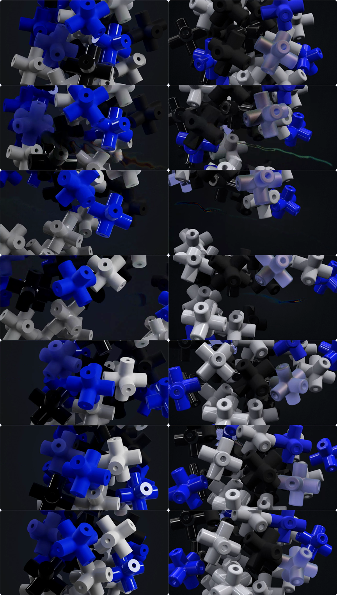

# hero-clone-test

Teste da skill **reanimate**: reconstrução, do zero, da primeira seção (hero) de um site de estúdio 3D, medindo o original e iterando até o movimento bater.

> **Projeto de estudo e teste.** Criado apenas para testar a skill reanimate e estudar movimento/WebGL. Sem fins comerciais, sem vínculo com o estúdio e sem pretensão de substituir o site original.
>
> Estudo de movimento. Não é o site original: modelos 3D, shaders, fonte (Aeonik) e logo **não** foram copiados. A geometria é gerada por código, a fonte é Inter Tight e o logo é texto. Todo o código aqui é novo.

## Rodar

```powershell
node serve.mjs
```

Abra http://127.0.0.1:5173/ (precisa de internet: three.js r158 e Inter Tight vêm de CDN). Layout fixo para 1440×900. Use `?t=3300` para congelar a intro em um milissegundo.

## O que tem

| arquivo | função |
|---|---|
| `index.html`, `main.js` | layout, intro (loader, contador, janelas em "L") e revelação do DOM |
| `world.js` | cena 3D, materiais, oclusão entre peças, composição final |
| `jack.js` | peça gerada por campo de distância (SDF) + surface nets |
| `physics.js` | corpos rígidos (esferas), cursor como raio, giro em repouso |
| `paint.js` | rastro do mouse (campo de velocidade em ¼ de resolução) |

## Resultado

- Intro e UI: 0,2–2 % de diferença por quadro, timing 0 s.
- Física, calibrada reproduzindo a trajetória de mouse gravada no original: tamanho em repouso 2,56 (ref. 2,55), retorno após varredura 1,94 s (ref. 1,90 s), deslocamento com mouse lento 0,84 (ref. 0,81).
- Detalhes e limites em [docs/report.md](docs/report.md) e [docs/spec.md](docs/spec.md).


